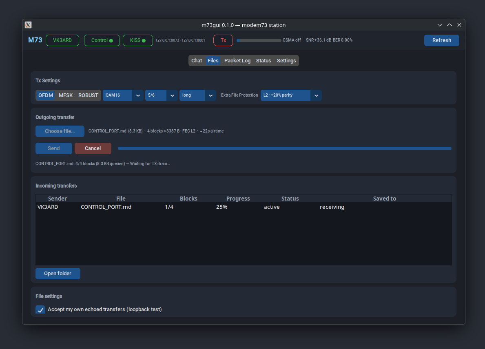

# m73gui

A desktop GUI for [modem73](https://github.com/RFnexus/modem73) - a amateur-radio
OFDM/MFSK/RDM data modem. 




## Why

Sending anything meaningful over a ~1 kbps radio link is fiddly: you need to know
the current mode's payload size, slice files into frames by hand, and you have no
visibility into what the modem is doing. m73gui handles the framing, pacing and reassembly
for you, and shows you the channel while it happens. It talks to modem73 purely
over its network ports (JSON control + KISS data), so the GUI can run on a laptop
next to the radio, or across the house from a machine hosting the audio.


## Features

- **Chat** - free-text messages broadcast to everyone on the channel, with a
  scrolling history that is rebuilt from modem73's frame history after
  reconnects.
- **Files** - pick a file (up to 1 MiB), choose a mode and a Reed–Solomon FEC
  level, see the block count and estimated airtime.
  Lost packets are repaired by the receiver's error correction — no
  retransmits, no per-chunk bookkeeping. Incoming transfers reassemble
  automatically into `~/.m73gui/received/<yyyy-mm-dd>/` with SHA-1
  verification; the sender can pick from L1 (~14% overhead) to L4 (+100%).
- **Packet Log** - a live table of every decoded frame (mode, SNR, BER, payload) with
  a detail view, plus a summary of everything you transmit.
- **Status** - link-quality trend charts fed by every decoded frame (per-frame
  SNR and BER), an occupancy bar, population/TX-queue/PTT metrics, modem error
  counters, and audio/rigctld health.
- **Settings** - callsign, CSMA, TX, and RX-decoder fields in a validated form;
  only changed fields are written back. 


The app never keys the radio by itself - it only frames data and hands it to
modem73, which does its own CSMA before transmitting.


## Requirements

- Python 3.14+ and [uv](https://docs.astral.sh/uv/)
- [modem73](https://github.com/RFnexus/modem73) running with both its control port
  (default `127.0.0.1:8073`) and KISS port (default port `8001`) enabled
- Amateur radio privileges for whatever you transmit, obviously

Runtime dependencies are `customtkinter` and `reedsolo`


## Running

```sh
uv sync
uv run m73gui
```

That connects to modem73 on localhost. To drive a remote modem:

```sh
uv run m73gui 192.168.1.50                    # control on :8073, KISS on :8001
uv run m73gui 192.168.1.50:8073 --kiss 192.168.1.50:8001
```

A remote setup needs modem73 started with `--control-bind` on a reachable address
(it binds to localhost by default).

Other flags: `--appearance dark|light|system`, `--debug` (protocol logging to
stderr), `--version`.


## State on disk

Everything m73gui keeps lives under `~/.m73gui/`:

| Path | What |
| --- | --- |
| `settings.json` | per-tab mode choices, FEC level, loopback preference (survives restarts) |
| `logs/m73gui.log` | rotating log (1 MB × 3) |
| `received/<yyyy-mm-dd>/` | completed incoming files, one folder per day |


## Things to know

- **Broadcast only.** Chat and files have no addressing, no ACKs, and no resume.
  File losses are repaired by forward error correction up to the chosen level
  (L2 fixes roughly 1 lost packet in 6); beyond that the transfer is marked
  failed and you re-send.
- **Nothing is private.** Every connected KISS client — on any m73gui instance —
  sees all decoded payloads.
- **Transfers are auto saved.** Incoming files land in
  `~/.m73gui/received/<yyyy-mm-dd>/` with duplicate names de-duplicated
  automatically.
- **Mode edits apply on Send.** The Chat and Files Tx Settings cards are
  independent intentions; pressing Send pushes the mode to the modem first,
  then transmits on it.


## Development

Tests use plain `unittest` (no modem or display required):

```sh
uv run python -m unittest discover -s tests
uv run python -m unittest discover -s src/rsfec/tests
```


## AI Disclosure

This project was heavily assited by local LLMs.
